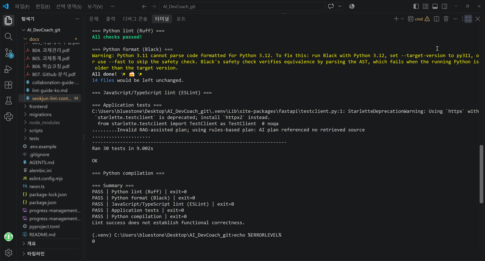
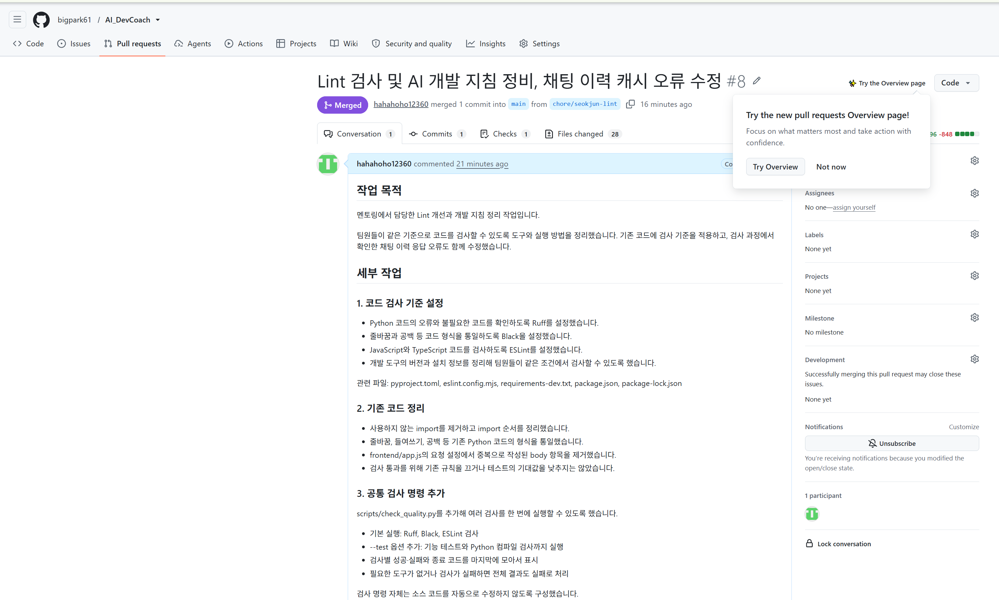

# 최석준 Lint 및 AI 개발 지침 담당 기여 기록

담당자: 최석준

관련 과제: 2026년 11월 16일 AI DevCoach 멘토링 일지 2.1

작업 방식: AI 도구의 도움으로 설정·코드·문서 초안을 준비하고 담당자가
적용, 실행 결과 확인, 변경 검토와 Git 기록을 진행한다.
아래 미완료 항목은 실제 수행한 뒤 체크하고 값을 채운다.

## 담당 산출물

| 멘토링 요구 | 산출물 | 확인 방법 |
| --- | --- | --- |
| 프로젝트에 맞는 Lint 설정 | pyproject.toml, eslint.config.mjs, requirements-dev.txt, package.json 및 lock 파일 | Python·JavaScript·TypeScript 검사 범위와 버전 확인 |
| 기존 코드에 적용 | Python import·포맷 정리, app.js 중복 body 삭제 | Git diff에서 변경 원인 설명 |
| 관련 테스트 및 변경 확인 | scripts/check_quality.py, 캐시 헤더 수정 | 다섯 검사 PASS와 30개 테스트 OK 확인 |
| 팀 공통 명령 정리 | docs/lint-guide-ko.md, README.md | 팀원이 동일 명령으로 실행 가능한지 확인 |
| SKILL.md 작성·공유 | .agents/skills/lint/SKILL.md, AGENTS.md | 구현 전·중·후 절차와 실제 명령 연결 확인 |
| 커밋·푸시로 기여 남기기 | 담당자 커밋과 PR | 아래 실제 주소 기록 |

## 확인된 수행 기록

- [O] 최초 Lint 개선 패치를 사용자 PC에 적용하고 공통 검사 실행 화면을 확인했다.
- [O] 제공한 화면에서 Ruff·Black·ESLint·컴파일 PASS 및 기존 기능 테스트 실패 1건을 확인했다.
- [O] 캐시 헤더 누락이 원인이며, 테스트 삭제 없이 응답 헤더를 수정하는 후속 개선안을 준비했다.
- [O] 후속 패치를 사용자 PC에 적용했다.
- [O] 사용자 PC에서 30개 테스트 OK, 검사 다섯 항목 PASS, 종료 코드 0을 확인했다.
- [O] SKILL.md와 설정 파일을 읽고 각 도구의 역할과 실행 절차를 설명할 수 있다.
- [O] git diff와 스테이징 목록을 확인했다.
- [O] 본인 Git 작성자 정보로 커밋하고 작업 브랜치를 푸시했다.
- [O] 팀 검토용 PR을 만들고 담당 산출물과 검사 결과를 공유했다.

사용자 PC 최종 실행 일시: 2026.11.18. 01:10

최종 실행 명령: .venv\Scripts\python.exe scripts/check_quality.py --test

사용자 PC 최종 결과: Ruff·Black·ESLint·Python 컴파일 검사 통과.
기능 테스트 30개 통과. 전체 종료 코드 0.

코드 변경 커밋 URL: (https://github.com/bigpark61/AI_DevCoach/commit/26df12793ff4999965dd69c9621dffcdf6716b94)

PR URL: (https://github.com/bigpark61/AI_DevCoach/pull/8)

화면 증빙 파일 또는 제출 위치: docs/testing/evidence/2026-11-18/
### 검사 결과

### PR 병합 완료

