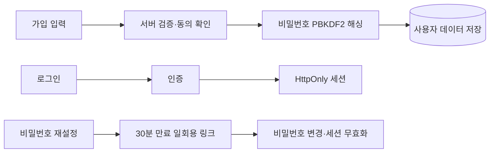

# AI DevCoach 기능 모듈 설계서 — FR-01 사용자 등록·인증·프로필

**공통 환경:** Python 3.12+, FastAPI, 웹 UI/JavaScript, 로컬 SQLite(`data/devcoach.db`), 운영 Neon PostgreSQL, Alembic, OpenAI 호환 API. API 키·DB 접속정보는 서버 측 환경변수로 관리.

## 1. 목적 및 범위
- 회원가입, 로그인/로그아웃, 필수 동의 기록, 비밀번호 재설정, 학습자 프로필 생성·수정.
- 이메일·비밀번호 인증, PBKDF2 비밀번호 해싱, HttpOnly 세션 쿠키, 30분 만료 1회용 재설정 링크, 비밀번호 변경 시 활성 세션 무효화.
- 이메일 주소 인증은 MVP에서 제공되지 않음.

## 2. 사용자·화면
| 화면      | 주요 입력·출력         | 동작               |
| ------- | ---------------- | ---------------- |
| 회원가입    | 이메일, 비밀번호, 필수 동의 | 입력 검증 → 계정 생성    |
| 로그인     | 이메일, 비밀번호        | 인증 → 세션 쿠키 발급    |
| 비밀번호 찾기 | 계정 이메일           | 1회용 재설정 링크 요청    |
| 비밀번호 변경 | 토큰, 새 비밀번호       | 만료·사용 여부 검증 후 변경 |
| 학습자 프로필 | 학습 관련 기본정보       | 조회·등록·수정         |

## 3. 처리 흐름

## 4. 데이터·API 설계
- **[확인 필요]** 실제 테이블명, 컬럼명, HTTP 경로 및 응답 스키마는 코드에서 확정.
- **[상세설계 제안]** `users`, `learner_profiles`, `consents`, `password_reset_tokens`, `sessions` 등 논리 엔터티로 분리 검토. 기존 스키마를 임의 변경하지 않음.
- 서버 인증 필수, 자기 프로필만 접근, 관리자는 별도 권한 처리.

## 5. 환경·예외·보안
- SMTP: `APP_BASE_URL`, `SMTP_HOST`, `SMTP_PORT`, `SMTP_FROM`, 필요 시 `SMTP_USERNAME`, `SMTP_PASSWORD`, `SMTP_USE_SSL`.
- 로컬 테스트 전용 `PASSWORD_RESET_DEV_MODE=true`는 운영 배포에서 금지.
- HTTPS 배포 시 `COOKIE_SECURE=true`; `.env`·비밀번호·토큰 노출 금지.
- **[상세설계 제안]** 중복 이메일, 잘못된 로그인, 만료·재사용 토큰, 비인가 프로필 조회, 입력 검증 오류 테스트.

## 6. 인수 테스트
- [ ] 정상 가입·로그인·로그아웃
- [ ] 필수 동의 미선택 차단 및 동의 기록 확인
- [ ] 비밀번호 재설정 링크 30분 만료·1회 사용 확인
- [ ] 재설정 후 기존 세션 무효화
- [ ] 본인 프로필 수정 및 타인 프로필 접근 차단
- [ ] 운영 SMTP 실제 발송·쿠키 속성 검증

## 7. 개발·검증 근거 및 확정란
- 실제 소스 파일/함수: **[코드 확인 후 기입]**
- 실제 API 요청·응답 예시: **[코드 확인 후 기입]**
- 실제 DB 테이블·컬럼: **[코드 확인 후 기입]**
- 화면 캡처/테스트 로그: **[첨부 예정]**
- 담당 팀원/검토자: **[작성 예정]**
- 최종 확인일: **[작성 예정]**

## 참고 링크
- [GitHub 저장소](https://github.com/bigpark61/AI_DevCoach)
- [배포 URL (README 기재)](https://ai-dev-coach.vercel.app)
