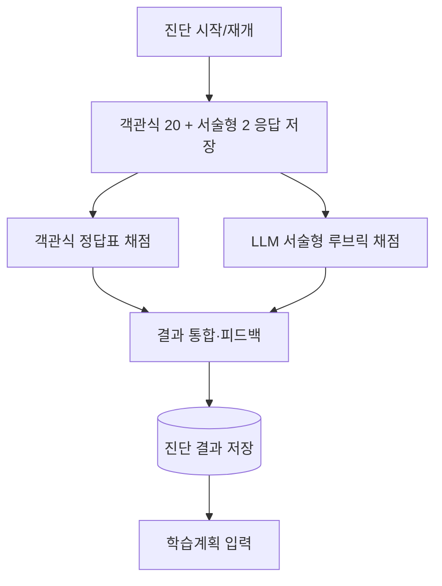

# AI DevCoach 기능 모듈 설계서 — FR-02 AI 수준진단

**버전:** v1.0 (구현 근거 기반 초안)  
**작성일:** 2026-11-19  
**원본:** `README.md`, `README_final.md`  

> **문서 기준:** 2026-11-19 제공 `README.md` 및 `README_final.md`의 확인 가능한 구현 설명. 원격 GitHub 소스의 함수·라우트·DB 스키마를 직접 검증한 문서가 아니므로, 아래 **[상세설계 제안]** 항목은 실제 코드와 대조 후 확정해야 합니다. **[구현 확인]**은 README에 명시된 기능이라는 의미이며 배포 환경 E2E 검증 완료를 의미하지 않습니다.

**공통 환경:** Python 3.12+, FastAPI, 웹 UI/JavaScript, 로컬 SQLite(`data/devcoach.db`), 운영 Neon PostgreSQL, Alembic, OpenAI 호환 API. API 키·DB 접속정보는 서버 측 환경변수로 관리.

## 1. 목적 및 범위
- **[구현 확인]** 총 22문항: 객관식 20문항 + 서술형 2문항, 중단 후 이어하기, 역량 피드백.
- 객관식은 정답 키 비교, 서술형은 OpenAI 호환 LLM 채점.
- **[구현 확인]** 서술형 평가 기준: 원인 이해 4점, 해결책 4점, 명확성 2점(각 답안의 평가 기준으로 기술됨; 전체 합산·환산 방식은 코드 확인 필요).

## 2. 화면 및 사용자 동작
| 화면 | 주요 요소 | 동작 |
|---|---|---|
| 진단 안내 | 문항 수, 진행 안내 | 진단 시작·이어하기 |
| 객관식 풀이 | 질문, 보기, 선택 | 답안 저장·다음 문항 |
| 서술형 풀이 | 질문, 자유 입력 | 답안 저장·제출 |
| 결과 | 점수·영역별 피드백 | 결과 확인·학습계획 이동 |

## 3. 처리 흐름

## 4. 정답 및 보기 데이터 무결성
- **[상세설계 제안]** 각 객관식 문항에 `options` 배열과 `answer_index`(0부터 시작)를 명시.
- 화면에 출력된 선택지에 정답이 반드시 포함되도록 검증; `options.slice(1)` 등 첫 항목 제거 여부 확인.
- Q18~Q20에서 정답 문구가 설명 영역에 표시되지만 보기에는 누락된 화면 사례가 사용자 검토 중 발견됨. **원인은 미확정**이며 원본 문항 데이터와 렌더링 로직을 대조해야 함.
- 시험 중 정답/해설 비노출, 제출 후 공개 시점 구분.

## 5. AI 채점·예외
- `OPENAI_API_KEY` 미설정 시 서술형 AI 채점은 설정 오류로 처리된다고 README에 명시.
- **[상세설계 제안]** 채점 응답을 구조화해 점수 범위·근거 필드 검증; 재시도·중복 제출·비정상 응답 로그 처리.
- **[확인 필요]** 실제 AI 프롬프트, 점수 합산 방식, API 경로, DB 테이블명.

## 6. 인수 테스트
- [ ] 22문항 구성 및 객관식 정답 보기 포함 여부 전수 검사
- [ ] 중단 후 이어하기 및 답안 저장
- [ ] 객관식 정답 인덱스/채점 일치
- [ ] 서술형 루브릭 점수·피드백 확인
- [ ] API 키 누락·응답 실패 처리
- [ ] Q18~Q20 정답 보기 누락 재현·수정·회귀 테스트

## 7. 개발·검증 근거 및 확정란
- 실제 소스 파일/함수: **[코드 확인 후 기입]**
- 실제 API 요청·응답 예시: **[코드 확인 후 기입]**
- 실제 DB 테이블·컬럼: **[코드 확인 후 기입]**
- 화면 캡처/테스트 로그: **[첨부 예정]**
- 담당 팀원/검토자: **[작성 예정]**
- 최종 확인일: **[작성 예정]**

## 참고 링크
- [GitHub 저장소](https://github.com/bigpark61/AI_DevCoach)
- [배포 URL (README 기재)](https://ai-dev-coach.vercel.app)
