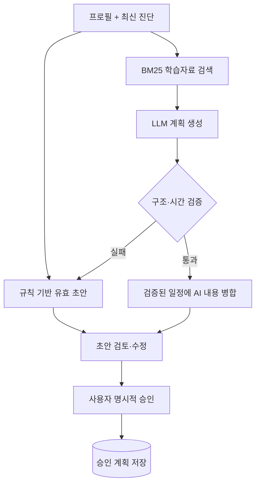

# AI DevCoach 기능 모듈 설계서 — FR-03 개인별 학습계획 생성

**버전:** v1.0 (구현 근거 기반 초안)  
**작성일:** 2026-11-19  
**원본:** `README.md`, `README_final.md`  

> **문서 기준:** 2026-11-19 제공 `README.md` 및 `README_final.md`의 확인 가능한 구현 설명. 원격 GitHub 소스의 함수·라우트·DB 스키마를 직접 검증한 문서가 아니므로, 아래 **[상세설계 제안]** 항목은 실제 코드와 대조 후 확정해야 합니다. **[구현 확인]**은 README에 명시된 기능이라는 의미이며 배포 환경 E2E 검증 완료를 의미하지 않습니다.

**공통 환경:** Python 3.12+, FastAPI, 웹 UI/JavaScript, 로컬 SQLite(`data/devcoach.db`), 운영 Neon PostgreSQL, Alembic, OpenAI 호환 API. API 키·DB 접속정보는 서버 측 환경변수로 관리.

## 1. 목적 및 범위
- **[구현 확인]** 학습자 프로필 및 최신 수준진단 결과에 기반한 주간 학습계획 초안 생성, 수정, 유효성 검증, 명시적 승인.
- **[구현 확인]** AI 제공업체가 구성되면 로컬 학습자료 검색을 활용한 생성이 가능하며, AI 오류·검색 자료 부재·검증 실패 시 규칙 기반 계획을 유지.

## 2. 화면 구성
| 화면 | 주요 요소 | 사용자 동작 |
|---|---|---|
| 생성 조건 | 프로필·최근 진단 요약 | 조건 확인·생성 요청 |
| 계획 초안 | 주차별 목표·학습 활동 | 초안 확인 |
| 계획 수정 | 주차·학습 항목 | 수정 저장 |
| 승인 | 검증 결과·최종 계획 | 승인·대시보드 이동 |

## 3. 생성 처리

## 4. 업무 규칙
- 승인 전 계획은 초안으로 관리하고 승인된 계획과 구분.
- **[상세설계 제안]** 계획 버전, 승인 시각, 수정 이력 및 진단 결과 참조 ID 저장.
- **[확인 필요]** 실제 주차 수, 학습시간 상한, 계획 수정 필드, 엔드포인트, DB 스키마.
- Agent 도구는 읽기 전용이므로 계획 변경은 전용 애플리케이션 흐름에서 수행.

## 5. 예외 및 인수 테스트
- [ ] 프로필·진단 입력을 이용한 계획 생성
- [ ] AI 성공 시 검색 근거 사용 및 구조 검증
- [ ] AI 미설정·오류 시 규칙 기반 계획 유지
- [ ] 초안 수정 저장·승인 및 중복 승인 처리
- [ ] 다른 사용자 계획 접근 차단

## 7. 개발·검증 근거 및 확정란
- 실제 소스 파일/함수: **[코드 확인 후 기입]**
- 실제 API 요청·응답 예시: **[코드 확인 후 기입]**
- 실제 DB 테이블·컬럼: **[코드 확인 후 기입]**
- 화면 캡처/테스트 로그: **[첨부 예정]**
- 담당 팀원/검토자: **[작성 예정]**
- 최종 확인일: **[작성 예정]**

## 참고 링크
- [GitHub 저장소](https://github.com/bigpark61/AI_DevCoach)
- [배포 URL (README 기재)](https://ai-dev-coach.vercel.app)
