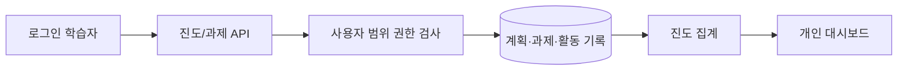

# AI DevCoach 기능 모듈 설계서 — FR-04 개인별 진도관리

**버전:** v1.0 (구현 근거 기반 초안)  
**작성일:** 2026-11-19  
**원본:** `README.md`, `README_final.md`  

> **문서 기준:** 2026-11-19 제공 `README.md` 및 `README_final.md`의 확인 가능한 구현 설명. 원격 GitHub 소스의 함수·라우트·DB 스키마를 직접 검증한 문서가 아니므로, 아래 **[상세설계 제안]** 항목은 실제 코드와 대조 후 확정해야 합니다. **[구현 확인]**은 README에 명시된 기능이라는 의미이며 배포 환경 E2E 검증 완료를 의미하지 않습니다.

**공통 환경:** Python 3.12+, FastAPI, 웹 UI/JavaScript, 로컬 SQLite(`data/devcoach.db`), 운영 Neon PostgreSQL, Alembic, OpenAI 호환 API. API 키·DB 접속정보는 서버 측 환경변수로 관리.

## 1. 목적 및 범위
- **[구현 확인]** 로그인 사용자 본인의 학습 진도 및 과제 목록 조회, 학습·과제 진행 정보의 관리자 요약 조회.
- README에는 과제 제출/완료, 학습시간 기록, 활동 로그 정렬에 대한 검증 체크리스트가 기재되어 있으나 각 화면·API의 구현 상세는 확인 필요.

## 2. 화면 구성
| 화면 | 표시 항목 | 동작 |
|---|---|---|
| 나의 학습현황 | 승인 계획·진행 상태 요약 | 상세 진입 |
| 주차별 계획 | 주차별 학습 항목 | 조회 |
| 과제 목록 | 개인 과제·완료 상태 | 조회·수행 기록(코드 확인 필요) |
| 활동 기록 | 학습 이력, 최신순 | 조회 |

## 3. 데이터 흐름

## 4. 산정 및 데이터 규칙
- **[상세설계 제안]** 완료율 = 완료 과제 수 / 배정 과제 수 × 100; 분모가 0이면 0% 또는 '해당 없음'으로 정책 확정.
- **[상세설계 제안]** 지연·진행 중·완료 상태 정의와 완료 판정 시점을 명세.
- **[확인 필요]** 실제 진행률 산식, 테이블, API 경로, 학습시간 로그 필드.
- README에 과거 SQLite 정렬 구현 `ORDER BY created_at DESC, rowid DESC`가 언급됨. `rowid`는 SQLite 전용이므로 PostgreSQL 호환 정렬 기준 검증 필요.

## 5. Agent 연동
- **[구현 확인]** AI Coach는 본인의 현재 진도와 과제 목록을 읽기 전용 도구로 조회할 수 있음.
- 진도 수정·완료 처리는 Agent Tool Calling으로 수행하지 않음.

## 6. 인수 테스트
- [ ] 사용자별 진도·과제 데이터 분리
- [ ] 완료율 및 빈 과제 목록 처리
- [ ] 활동 기록 최신순·동일 시각 정렬
- [ ] 계획 승인 전후 표시 차이
- [ ] SQLite·PostgreSQL 동일 동작 검증

## 7. 개발·검증 근거 및 확정란
- 실제 소스 파일/함수: **[코드 확인 후 기입]**
- 실제 API 요청·응답 예시: **[코드 확인 후 기입]**
- 실제 DB 테이블·컬럼: **[코드 확인 후 기입]**
- 화면 캡처/테스트 로그: **[첨부 예정]**
- 담당 팀원/검토자: **[작성 예정]**
- 최종 확인일: **[작성 예정]**

## 참고 링크
- [GitHub 저장소](https://github.com/bigpark61/AI_DevCoach)
- [배포 URL (README 기재)](https://ai-dev-coach.vercel.app)
