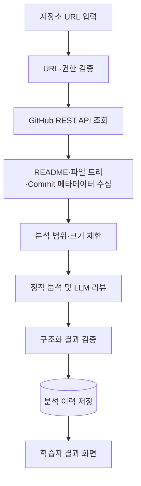

# AI DevCoach 기능 모듈 설계서 — FR-05 GitHub 프로젝트 분석

**버전:** v1.0 (구현 근거 기반 초안)  
**작성일:** 2026-11-19  
**원본:** `README.md`, `README_final.md`  

> **문서 기준:** 2026-11-19 제공 `README.md` 및 `README_final.md`의 확인 가능한 구현 설명. 원격 GitHub 소스의 함수·라우트·DB 스키마를 직접 검증한 문서가 아니므로, 아래 **[상세설계 제안]** 항목은 실제 코드와 대조 후 확정해야 합니다. **[구현 확인]**은 README에 명시된 기능이라는 의미이며 배포 환경 E2E 검증 완료를 의미하지 않습니다.

**공통 환경:** Python 3.12+, FastAPI, 웹 UI/JavaScript, 로컬 SQLite(`data/devcoach.db`), 운영 Neon PostgreSQL, Alembic, OpenAI 호환 API. API 키·DB 접속정보는 서버 측 환경변수로 관리.

## 1. 목적 및 구현 상태
- 기존 프로젝트의 **확장 대상 기능**으로, GitHub 저장소를 수집하여 README·코드·Commit 등 개발 산출물을 분석하는 모듈을 설계함.
- **[미구현/확인 필요]** 제공된 README에는 GitHub 코드 분석 기능의 실제 구현·API·DB 테이블이 확인되지 않음. GitHub를 협업 저장소로 사용하는 것과 학습자의 GitHub 프로젝트를 자동 분석하는 것은 별개임.

## 2. 화면 설계 [상세설계 제안]
| 화면 | 입력·출력 | 동작 |
|---|---|---|
| 저장소 분석 요청 | GitHub URL, Branch/Commit(선택) | 분석 요청 |
| 분석 진행 | 단계·상태·오류 | 진행 확인 |
| 분석 결과 | 구조, README, 코드 품질, 개선사항 | 결과 조회 |
| 분석 이력 | 요청 시각·저장소·버전·상태 | 이전 결과 비교 |

## 3. 처리 흐름 [상세설계 제안]

## 4. 기능 요구사항 [상세설계 제안]
- 공개 저장소 우선 지원, 비공개 저장소는 사용자 승인과 최소권한 토큰 정책이 확정된 경우에만 지원.
- 분석 시점 Commit SHA를 기록해 재현성 확보.
- 코드·README·변경 이력을 별도 평가 항목으로 구분하고 파일·라인 등 근거 제시.
- LLM 추정으로 '실행 성공'을 단정하지 않고 실제 테스트 결과와 구분.
- 저장소 URL 검증, API rate limit, 대용량/바이너리 파일 제외, 토큰 비노출.

## 5. 논리 데이터·API [상세설계 제안]
- 엔터티: `github_repositories`, `analysis_requests`, `analysis_results`(실제 테이블 아님).
- 후보 API: `POST /api/github/analyses`, `GET /api/github/analyses/{id}`, `GET /api/github/analyses` (**제안 경로, 현재 구현 확인 불가**).

## 6. 인수 테스트
- [ ] 정상 공개 저장소 분석·Commit 고정
- [ ] 존재하지 않는 저장소·권한 거부·API 제한 처리
- [ ] README 누락·빈 저장소·대용량 파일 처리
- [ ] 결과 근거·점수 구조 검증
- [ ] 다른 학습자의 분석 결과 접근 차단

## 7. 개발·검증 근거 및 확정란
- 실제 소스 파일/함수: **[코드 확인 후 기입]**
- 실제 API 요청·응답 예시: **[코드 확인 후 기입]**
- 실제 DB 테이블·컬럼: **[코드 확인 후 기입]**
- 화면 캡처/테스트 로그: **[첨부 예정]**
- 담당 팀원/검토자: **[작성 예정]**
- 최종 확인일: **[작성 예정]**

## 참고 링크
- [GitHub 저장소](https://github.com/bigpark61/AI_DevCoach)
- [배포 URL (README 기재)](https://ai-dev-coach.vercel.app)
