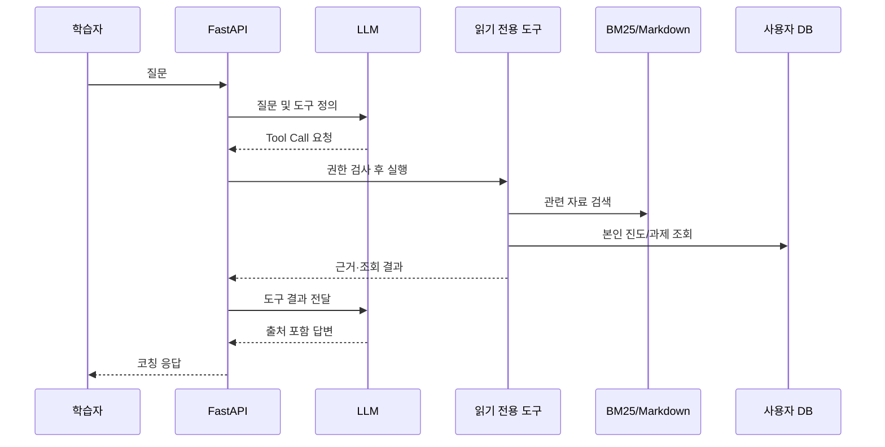

# AI DevCoach 기능 모듈 설계서 — FR-06 AI 코칭

**버전:** v1.0 (구현 근거 기반 초안)  
**작성일:** 2026-11-19  
**원본:** `README.md`, `README_final.md`  

> **문서 기준:** 2026-11-19 제공 `README.md` 및 `README_final.md`의 확인 가능한 구현 설명. 원격 GitHub 소스의 함수·라우트·DB 스키마를 직접 검증한 문서가 아니므로, 아래 **[상세설계 제안]** 항목은 실제 코드와 대조 후 확정해야 합니다. **[구현 확인]**은 README에 명시된 기능이라는 의미이며 배포 환경 E2E 검증 완료를 의미하지 않습니다.

**공통 환경:** Python 3.12+, FastAPI, 웹 UI/JavaScript, 로컬 SQLite(`data/devcoach.db`), 운영 Neon PostgreSQL, Alembic, OpenAI 호환 API. API 키·DB 접속정보는 서버 측 환경변수로 관리.

## 1. 목적 및 범위
- **[구현 확인]** AI Coach가 학습 질문에 답하고 로컬 학습자료 검색 결과의 출처 ID를 표시.
- **[구현 확인]** 읽기 전용 Tool Calling: 학습자료 검색, 로그인 사용자의 현재 진도 조회, 본인의 과제 목록 조회.
- **[구현 확인]** AI 제공업체가 미설정되면 Agent 채팅은 설정 오류; 기존 기록 기반 진도 코치는 사용 가능.

## 2. 화면 구성
| 화면 | 주요 요소 | 동작 |
|---|---|---|
| AI 코칭 채팅 | 질문 입력, 답변, 출처 ID | 질문·답변 |
| 참고자료 | 검색된 학습자료 근거 | 출처 확인 |
| 개인 맥락 | 본인 진도·과제 | 조회 도구 결과 기반 답변 |
| 대화 이력 | 과거 대화 목록 | **[확인 필요]** 보존·재조회 기능 구현 여부 |

## 3. Agent + RAG 구조

## 4. RAG 파이프라인
- **자료원:** `backend/knowledge/`의 선별된 Markdown 문서.
- **검색:** BM25 기반 어휘 검색; 임베딩/벡터 DB 또는 임의 외부문서 수집은 현재 지원하지 않음.
- **생성:** 검색된 문맥과 사용자 질문을 LLM에 전달; 출처 ID 표시.
- **[상세설계 제안]** 검색 실패·근거 부족 시 불확실성 고지, 출처 ID 실재 여부 검증.

## 5. Long-term Memory 경계
- **[구현 확인]** 프로필·진단·계획·진도 데이터가 DB에 보존되어 개인 맥락 조회의 기반 제공.
- **[미확인]** 과거 코칭 대화를 장기 기억으로 자동 요약·재검색하고 자동 재계획하는 기능은 구현 완료로 확인되지 않음.
- Agent는 계획·진도를 직접 수정하지 않음.

## 6. 보안·인수 테스트
- [ ] 자료 검색·출처 ID 정상 출력
- [ ] 본인 진도·과제 도구 호출 및 타인 데이터 차단
- [ ] 도구가 계획·진도 변경을 수행하지 못함
- [ ] AI 키 미설정·모델 오류·근거 없음 처리
- [ ] 프롬프트 인젝션에 의한 권한 우회 차단

## 7. 개발·검증 근거 및 확정란
- 실제 소스 파일/함수: **[코드 확인 후 기입]**
- 실제 API 요청·응답 예시: **[코드 확인 후 기입]**
- 실제 DB 테이블·컬럼: **[코드 확인 후 기입]**
- 화면 캡처/테스트 로그: **[첨부 예정]**
- 담당 팀원/검토자: **[작성 예정]**
- 최종 확인일: **[작성 예정]**

## 참고 링크
- [GitHub 저장소](https://github.com/bigpark61/AI_DevCoach)
- [배포 URL (README 기재)](https://ai-dev-coach.vercel.app)
