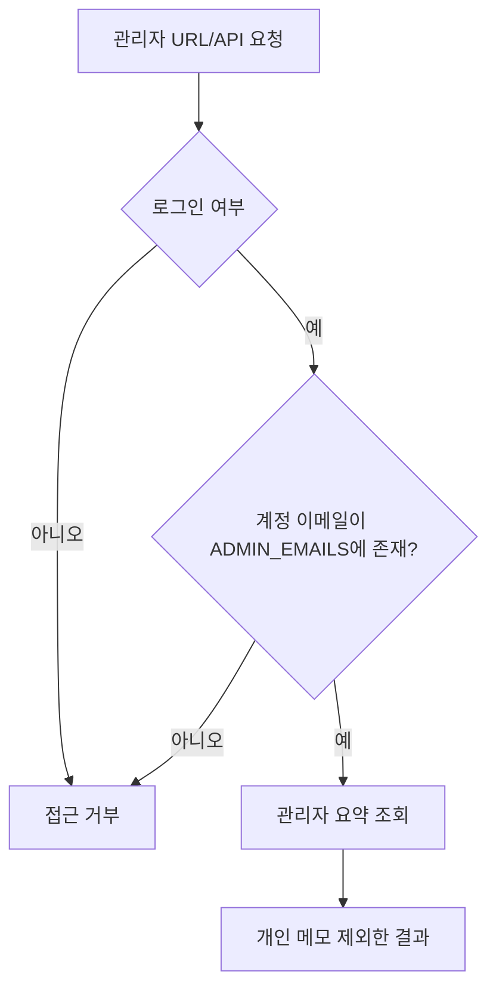

# AI DevCoach 기능 모듈 설계서 — FR-07 관리자 화면

**버전:** v1.0 (구현 근거 기반 초안)  
**작성일:** 2026-11-19  
**원본:** `README.md`, `README_final.md`  

> **문서 기준:** 2026-11-19 제공 `README.md` 및 `README_final.md`의 확인 가능한 구현 설명. 원격 GitHub 소스의 함수·라우트·DB 스키마를 직접 검증한 문서가 아니므로, 아래 **[상세설계 제안]** 항목은 실제 코드와 대조 후 확정해야 합니다. **[구현 확인]**은 README에 명시된 기능이라는 의미이며 배포 환경 E2E 검증 완료를 의미하지 않습니다.

**공통 환경:** Python 3.12+, FastAPI, 웹 UI/JavaScript, 로컬 SQLite(`data/devcoach.db`), 운영 Neon PostgreSQL, Alembic, OpenAI 호환 API. API 키·DB 접속정보는 서버 측 환경변수로 관리.

## 1. 목적 및 범위
- **[구현 확인]** `ADMIN_EMAILS` 환경변수에 등록된 기존 계정만 관리자 대시보드 및 `/api/admin/overview` 접근 가능.
- **[구현 확인]** 계정 수·과제 진행 상황 요약을 제공하며 학습자 개인 메모는 노출하지 않음.
- **[확인 필요]** 관리자 계정 CRUD, 과제 등록·배정·수정 기능의 실제 구현 여부는 제공 README에서 확정할 수 없음.

## 2. 화면 구성
| 메뉴 | 주요 표시·조작 | 상태 |
|---|---|---|
| 관리자 대시보드 | 계정 및 과제 진행 요약 | README 구현 설명 확인 |
| 교육생 현황 | 학습자별 요약·필터 | 상세 구현 확인 필요 |
| 과제 현황 | 과제별 진행 요약 | 상세 구현 확인 필요 |
| 과제 등록·배정 | 과제명, 요구사항, 기한, 대상 | **확장 설계 제안** |
| 운영 통계 | 완료율·미제출 현황·기간별 통계 | **확장 설계 제안** |

## 3. 접근제어 흐름

## 4. 구성·권한
- 설정 예: `ADMIN_EMAILS=coach@example.com,owner@example.com` (실제 주소 아님).
- README 기준 변경된 이메일 목록은 다음 요청부터 적용.
- 관리자 화면에서도 비밀번호·API 키·개인 메모·민감 데이터 출력 금지.
- **[상세설계 제안]** 향후 역할 기반 권한(RBAC), 과제 관리 이력, 변경 감사 로그 추가 검토.

## 5. API 및 데이터
- **[구현 확인]** `GET /api/admin/overview`로 설명된 관리자 진행 요약 API(HTTP 메서드는 코드 대조 필요; README는 경로만 명시).
- **[확인 필요]** 응답 필드, 집계 쿼리, 관리자 화면의 구체적인 URL 및 프론트엔드 구현 파일.

## 6. 인수 테스트
- [ ] 허용된 관리자 이메일 계정으로 대시보드 조회
- [ ] 일반 사용자 및 비로그인 접근 차단
- [ ] 관리자 목록 변경 후 권한 반영
- [ ] 개인 메모·민감정보 미노출
- [ ] 사용자/과제 집계가 실제 데이터와 일치

## 7. 개발·검증 근거 및 확정란
- 실제 소스 파일/함수: **[코드 확인 후 기입]**
- 실제 API 요청·응답 예시: **[코드 확인 후 기입]**
- 실제 DB 테이블·컬럼: **[코드 확인 후 기입]**
- 화면 캡처/테스트 로그: **[첨부 예정]**
- 담당 팀원/검토자: **[작성 예정]**
- 최종 확인일: **[작성 예정]**

## 참고 링크
- [GitHub 저장소](https://github.com/bigpark61/AI_DevCoach)
- [배포 URL (README 기재)](https://ai-dev-coach.vercel.app)
